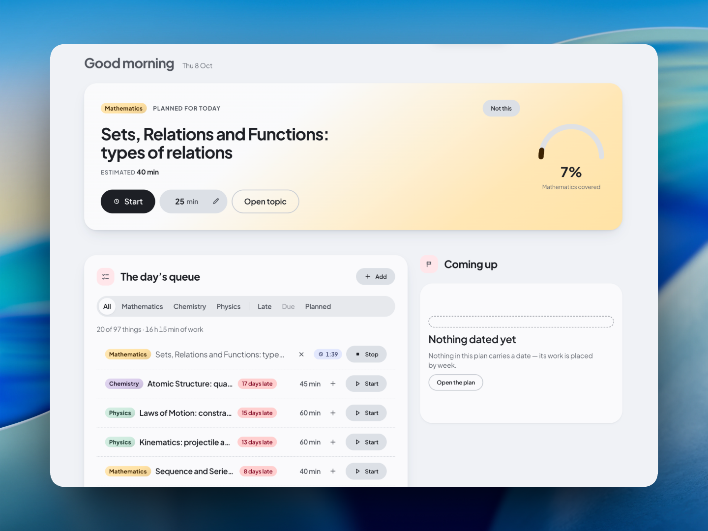

<p align="center">
  <a href="https://github.com/avinaxhroy/SAM">
    
  </a>
</p>

<h1 align="center">SAM</h1>

<p align="center">
  
</p>

<p align="center">
  A configurable, local-first study OS for desktop and terminal.
</p>

<p align="center">
  <a href="https://github.com/avinaxhroy/SAM/releases">
    
  </a>
</p>

Study tools assume one workflow: a to-do list with no idea of course prerequisites, flashcards detached from the syllabus, a dashboard built for a single kind of student. Studying doesn't look like that. Anatomy drills, engineering problem sets, and a slow read of a technical book want different screens and different ways of measuring progress.

SAM is built as an operating system rather than a fixed dashboard. Your curriculum, screens, and rules are plain JSON and line-delimited records on disk. Each kind of work carries its own progression pipeline, and reviews follow the plan's scheduler. The desktop app and the `sam` CLI read the same folder, so the same work is reachable by mouse, by keyboard, by editing the files, and by script.

---

## Getting started

### Prebuilt releases

Prebuilt binaries for macOS, Windows, and Linux are on [GitHub Releases](https://github.com/avinaxhroy/SAM/releases): a `.dmg`, an `.exe`, and an `.AppImage` or `.deb`. The desktop app needs macOS 13 or newer, Windows 10/11 with WebView2 109 or newer, or a Linux desktop with WebKitGTK 4.1. The published macOS build targets Apple Silicon; Intel Macs build from source.

#### macOS installation

```bash
brew install --cask avinaxhroy/tap/sam
```

Or download the DMG. Releases are ad-hoc signed rather than notarized, so Gatekeeper may block the first launch:

```bash
# If the downloaded DMG will not open:
xattr -d com.apple.quarantine ~/Downloads/SAM_*.dmg

# Or strip the flag after dragging SAM to /Applications:
xattr -cr /Applications/SAM.app
```

#### The `sam` CLI on your PATH

The app carries the CLI inside its bundle. *Install command line tool* in the View menu links it into a directory already on `PATH`: a symlink on macOS and Linux, asking the system to authorize the write where rights are needed, and a `PATH` append on Windows. After that `sam` works in any terminal, and agents like Claude Code or OpenCode can edit plans through the same commands the in-app assistant uses.

### Building from source

Prerequisites:

- **Rust** 1.96 or newer (the workspace uses the 2024 edition).
- **Node.js** 20.19 or newer, with **pnpm** 9 or newer.
- **Tauri CLI** 2: `cargo install tauri-cli --version "^2" --locked`.
- **Linux only:** `libwebkit2gtk-4.1-dev` and the usual Tauri build dependencies.

The desktop shell embeds the built frontend at compile time, so build the UI first:

```bash
# Frontend bundle
pnpm -C ui install
pnpm -C ui build

# Workspace, including the sam CLI
cargo build --workspace --release

# Copy the CLI to the name Tauri's bundler expects
node scripts/sidecar.mjs

# Run the app, or produce a bundle
cargo tauri dev
cargo tauri build
```

`sidecar.mjs` copies the release binary to `src-tauri/binaries/sam-<triple>`; it does not build anything. `cargo tauri build` runs the same copy through its build hook, so it needs the workspace build to have run.

The CLI is left at `target/release/sam`. A plain cargo build creates no `Resources` folder at `target/Resources`, where that binary looks for presets, themes, and tokens, so commands that read them fail. Point `SAM_RESOURCES` at the source resources when running from the checkout:

```bash
SAM_RESOURCES="$PWD/Sources/SAMCore/Resources" ./target/release/sam plan.new --preset seed --plan /tmp/demo
```

On first launch SAM asks for a plan name and a folder. The blank starter is the default, the bundled presets are one click away, and a folder that already holds a plan opens in place.

---

## The plan on disk

A study plan is a directory on your computer:

```
my-plan/
├── README.md              # what the plan is
├── content/
│   ├── types.json         # entity schemas (course, topic, session, assessment…)
│   ├── views.json         # screen layouts, block arrangements, and composed widgets
│   ├── rules.json         # schedulers, progression pipelines, and proof gates
│   ├── shell.json         # navigation destinations and keybindings
│   ├── appearance.json    # pinned theme and text scale
│   └── records/           # one file per kind, created with the first record
│       ├── course.jsonl   # line-by-line course records
│       ├── topic.jsonl    # syllabus topics with estimates and links
│       └── session.jsonl  # logged study sessions
├── state/
│   └── state.json         # progress and review history (created once there is progress)
└── .sam/                  # lock, settings, transaction journal and before-images
```

Records are line-delimited JSON (`.jsonl`): one record per line, so a change appears as one line in `git diff`. Git is optional. `.sam/` holds the lock, settings, journal, and before-images, never content.

The SQLite search index is derived, not part of the plan. It lives under the app's data directory at `indexes/<plan-name>-<hash>/index.sqlite`, rebuilds incrementally from the records, and can be deleted at any time. `sam paths --plan <dir> --json` prints the indexes folder and, when one exists, the index's path.

Plans live in the platform application data directory by default:

- **macOS**: `~/Library/Application Support/SAM/plans/<Plan Name>`
- **Linux**: `~/.local/share/SAM/plans/<Plan Name>`
- **Windows**: `%APPDATA%\SAM\plans\<Plan Name>`

`--plan <path>` targets any other directory.

---

## Screen composer

The rail's screens (Today, Plan, Courses, Reviews, Library, Notes, Progress) are built from widgets. Click the pencil in the titlebar to edit the current screen; **Add** in the rail opens the sheet for a new one.

- **12 widgets**, in two groups:
  - Today: Session card, Today's queue, Coming up, Week chart.
  - Study: Plan spine, Courses, Practice banks, Mocks calendar, Recall card, Review queue, Progress figures, Library.
- **Width**: half (`span: 1`) or full (`span: 2`).
- **Variants**: the `‹` and `›` chevrons on a frame cycle the designs that fit it.
- **Order**: drag a frame to a new position.
- **Removal**: the frame's own button, with an undo receipt.
- **Reset**: *Use SAM's design again* takes your components off and redraws the screen as SAM designed it.

The right-hand sidebar follows the selection: the screen's actions with nothing selected, the selected widget's own controls once a frame is pressed, and the record's fields once a row is pressed.

Layout edits write to `content/views.json` in one atomic transaction. `⌘Z` undoes them.

---

## Study methods

How you complete work is defined by progression pipelines in `content/rules.json`. Different kinds can use different completion rules:

- `check`: done or not done. Reading lists, lectures, outlines.
- `pages`: page tracking for books and long articles (`reading` → `read`).
- `progress`: multi-step coursework and projects (`started` → `midway` → `done`).
- `flip`: lecture and proof workflow (`learned` → `proved` → `anchored`). A proof gate on `watch` topics requires at least two solved problems before `proved`.
- `srs`: spaced repetition (`new` → `learning` → `review` → `mature`), driven by recall ratings.

Changing a kind's pipeline takes either one `--map` per stage a record has reached or `--fresh` to start a new active state. Replaced stages move to the record's history and are never reinterpreted:

```bash
sam type.setPipeline --type topic --pipeline check --map learned=done --map proved=done --plan ./my-plan
```

### Review schedulers

When an item enters a review queue, the plan's scheduler sets the next interval:

- **FSRS-6**: an embedded Rust implementation of the Free Spaced Repetition Scheduler, using 21 configurable weights to model memory stability and retrievability.
- **SuperMemo-2 (`sm2`)**: the classic ease factor and repetition intervals.
- **Fixed ladders (`fixed`)**: explicit day intervals; the starter plan uses `[1, 7, 30]`.

---

## Four surfaces

Every engine capability has four surfaces:

| Surface      | Interface              | How to use it                                                                                               |
| ------------ | ---------------------- | ----------------------------------------------------------------------------------------------------------- |
| **Click**    | Desktop app            | Tables, boards, the composer, timers, and sheets.                                                           |
| **Name**     | Command palette (`⌘K`) | Capture a record, run any command, or jump to a screen or record.                                           |
| **Text**     | Files and source pane  | Edit the plan's JSON and JSONL directly, or in the source pane (`⌘⇧J`); the watcher reloads within ~150 ms. |
| **Terminal** | `sam` CLI              | Every command id, with `--json` for scripts and agents.                                                     |

---

## Settings and sharing

Settings (`⌘,`) has five places, and the find field narrows any list:

- **The day**: daily targets, timezone, review scheduling.
- **How you work**: every shortcut the plan binds, and any collision between them.
- **Appearance**: theme, light or dark, text size.
- **Component styles**: the design each component draws with.
- **This plan**: export, import, which kinds stay personal, and every file the plan keeps.

Export writes a `*.samprofile` holding the plan's five config documents (schema, views, rules, shell, and appearance) plus the records that are not personal. Kinds marked personal stay behind unless you include them, and including them also carries progress. Import writes a new plan and opens it, and the app opens `.samprofile` files from the desktop.

---

## Command-line interface

Every action in the app carries a command id, and the `sam` binary dispatches the same ids:

```bash
# Create a plan from a preset, then read where things are
sam plan.new --preset university-term --plan ./my-plan
sam today.view --plan ./my-plan
sam paths --plan ./my-plan --json

# Add a course and a topic
sam course.new --id c.dm --name "Discrete Mathematics" --code CS101 --credits 4 --plan ./my-plan
sam topic.new --id t.logic --title "Propositional logic" --course c.dm --kind read --est 30 --plan ./my-plan

# Move a topic through its pipeline, then log a review
sam record.advanceStage --id t.logic --stage learned --plan ./my-plan
sam record.advanceStage --id t.logic --stage proved --problems 2 --plan ./my-plan
sam record.logReview --id t.logic --rating good --plan ./my-plan

# Preview and commit a batch, then validate the plan
sam apply updates.jsonl --dry-run --plan ./my-plan
sam apply updates.jsonl --plan ./my-plan
sam configcheck --plan ./my-plan
```

Each kind also gets its own `.new` command (`sam topic.new`, `sam course.new`), so a record's fields are plain flags. `--json` is the default when output is not a terminal, and `sam --commands --plan ./my-plan --json` lists every id the plan exposes.

Exit codes: `0` success; `1` invalid plan or a refused write, including a failed proof gate; `2` usage; `3` conflicting concurrent write; `4` I/O failure; `5` presentation, where the command reports the desktop action it needs because no window is attached.

See [`docs/cli.md`](docs/cli.md) for batch transactions via stdin, revision pinning, and the full command surface.

---

## Authoring with AI

SAM exposes schema introspection and atomic batch ingestion through the CLI, so plans can be populated by the in-app assistant, by a coding agent at the terminal, or by a chatbot producing a batch file.

### In the app

The titlebar's sparkle (`⌘J`) opens the assistant. It runs one turn of an agent CLI already installed on this machine: Claude Code, OpenCode, GitHub Copilot CLI, Antigravity, Gemini CLI, Oh My Pi, or Pi. It works against the plan the window has open, wherever that folder lives, and writes through `sam` (stage, dry-run, commit against the revision it read), so its work lands as the same transactions yours do and open screens reload as records appear. A turn ends with a receipt and one Undo, and the model pill lists the models the chosen CLI reports.

SAM ships no model and no API keys; the CLI you already have does the thinking. The same turn runs headless: `sam agent.list` finds the installed CLIs, and `sam agent.run <prompt> --plan ./my-plan` runs one. See [`docs/ai-agents.md`](docs/ai-agents.md#3-using-the-assistant-inside-the-app) for the adapters.

### With a coding agent

An agent that can run shell commands can build a plan. Paste this prompt into its chat or terminal:

```text
Create a study plan for [my learning goal or syllabus] in ./my-plan using SAM. Follow the workflow in https://github.com/avinaxhroy/SAM/blob/main/docs/ai-agents.md:
1. Initialize the plan folder: sam plan.new --plan ./my-plan
2. Query the active schema and options: sam --schema --json --plan ./my-plan
3. Break the curriculum into courses, weeks, and topics, staging them in /tmp/batch.jsonl
4. Test with sam apply /tmp/batch.jsonl --dry-run --plan ./my-plan, then commit with sam apply /tmp/batch.jsonl --plan ./my-plan
5. Verify today's queue: sam today.view --plan ./my-plan
```

### With a chatbot

A chatbot cannot run commands, so it writes a batch file instead. Give it the schema specification at [`docs/ai-prompt.md`](docs/ai-prompt.md):

```text
Convert the following syllabus or learning goal into a SAM batch.jsonl file strictly following the specification at https://github.com/avinaxhroy/SAM/blob/main/docs/ai-prompt.md:

[Paste your syllabus, course outline, or learning goal here]
```

Then ingest the file:

```bash
# 1. Initialize a plan in any folder
sam plan.new --plan ./my-plan

# 2. Preview and validate records (dry run)
sam apply batch.jsonl --dry-run --plan ./my-plan

# 3. Commit records to disk
sam apply batch.jsonl --plan ./my-plan
```

The app's watcher picks the new records up without a restart.

---

## Keyboard shortcuts

| Shortcut               | Context | Action                                                        |
| ---------------------- | ------- | ------------------------------------------------------------- |
| `⌘K` / `Ctrl+K`        | Global  | Open the command palette: capture, commands, screens, records |
| `⌘J` / `Ctrl+J`        | Global  | Open the assistant                                            |
| `⌘⇧J` / `Ctrl+Shift+J` | Global  | Toggle the source pane                                        |
| `⌘,` / `Ctrl+,`        | Global  | Open settings                                                 |
| `⌘Z` / `Ctrl+Z`        | Global  | Undo the last persisted change (restores exact bytes)         |
| `⌘⇧Z` / `Ctrl+Shift+Z` | Global  | Redo                                                          |
| `Space`                | Reviews | Reveal the answer                                             |
| `1` / `2`              | Reviews | Grade **Forgot** / **Good** (after reveal)                    |
| `n`                    | Reviews | Show all four grades; `1`–`4` then grade the card             |
| `Esc`                  | Global  | Close the open sheet or palette                               |

A plan's bindings live in `content/shell.json`; Settings → *How you work* lists them and flags collisions, and any key the plan leaves unset falls back to the built-in default.

---

## Development and testing

```bash
# Workspace unit and integration tests
cargo test --workspace

# Design and specification checks
node tools/tokenlint.mjs
node tools/plancheck.mjs
node tools/presets.mjs

# Browser, accessibility, and census suite
node tools/gates.mjs
```

[`docs/development.md`](docs/development.md) covers the full setup, the browser harness, the quality gates, and the architectural rules, including the integration test that keeps Tauri out of the engine crates.

---

## Documentation

- [Architecture and engine design](docs/architecture.md)
- [Content model and schema definition](docs/content-model.md)
- [CLI reference and batch workflows](docs/cli.md)
- [Presets and curriculum templates](docs/presets.md)
- [Authoring with AI agents and chatbots](docs/ai-agents.md)
- [Schema specification for AI](docs/ai-prompt.md)
- [Development and contributing](docs/development.md)

---

## License

GNU Affero General Public License v3.0 (`AGPL-3.0-or-later`). See [LICENSE](LICENSE) for details.
